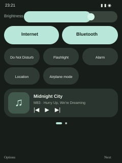
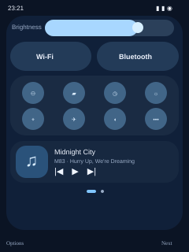
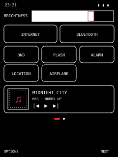
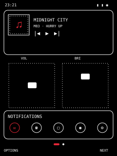

# QINS UI Studio

A modular Android UI customization platform for the Xiaomi QINS1+ (Android 4.4.4 / API 19), built with a no-root-first, reversible approach.

## Current implementation

- Android application scaffold with API 19 minimum and Java 8 source compatibility.
- **Physical-key-first UI:** D-pad / arrow navigation, OK / Enter activation, Back navigation, visible focus state and an in-app menu. No touch screen is required.
- **QINS Home launcher (first functional milestone):** a real Android HOME activity that can be selected as the device's default home screen. It discovers launchable apps, displays their icons and names in a keyboard-navigable grid, and opens selected apps. It reads the saved 2–4 column and 2–3 row preferences from Home Studio, and shows apps across keyboard-controlled pages.
- **Home Studio:** choose a 2–4 column by 2–3 row home-grid layout, preview it and save the preference locally. Both dimensions control the number of apps shown per QINS Home page.
- **Shared app theme layer:** Ocean, Midnight and Forest palettes are stored persistently and applied to current Studio screens and shared controls.
- English and Hebrew resource strings; RTL support is enabled.
- GitHub Actions debug APK build.

## Setting QINS Home as the default

Install the APK, press the device's physical Home key, select **QINS Home** in Android's home-app chooser and choose **Always**. If Android does not show a chooser, open the system's Home/Launcher default-app setting and select QINS Home. From then on Android can return to QINS Home when Home is pressed and use it as the home activity after boot. The exact menu labels depend on the QINS firmware.

To return to the original home screen, change the default Home app in Android settings. QINS Home does not uninstall or modify the original launcher.

## Scope boundary

QINS Home replaces the home screen only. The theme engine changes QINS UI Studio's own screens and menus; it does not recolor Android's system menus, notification shade, third-party apps or protected lock screen. Those require system-level integration, firmware support or privileged permissions and are not part of this no-root build.

## Build and installation

The CI workflow builds a debug APK using Gradle 8.2 and JDK 17. Download the artifact named `QINS-UI-Studio-debug` from a successful workflow run.

**Debug-signing note:** GitHub-hosted runners do not retain Android's generated debug keystore between runs. Until a persistent signing key is configured in GitHub Actions, APKs from different runs may not be installable as in-place updates. One clean uninstall may be required when changing signing keys; app-local preferences are then removed. Do not publish a private keystore in this public repository.

## Device validation

A successful CI build proves compilation and APK packaging only. Physical-key mapping, focus order, Hebrew rendering, app discovery, HOME selection, boot behavior, installation and performance must still be validated on the actual QINS1+ running Android 4.4.4.

---

## Standalone Quick Settings web prototype

A separate, dependency-free visual and interaction prototype for the QIN S1 240×320 screen. It does not change Android radios, volume or system settings; it is a browser-based keypad interaction harness.

- Open `index.html`; if ES modules are blocked by `file://`, serve this repository folder with any static HTTP server.
- Open `preview.html` to view all three phone frames and their keypad.
- Arrow keys move focus; Enter activates; left/right adjust a focused slider; Backspace returns; Q/E switch pages; 1/2/3 switch themes.
- The Nothing theme bundles a dot-matrix WOFF2 font as a local data asset; no font or other resource is fetched from the network.
- Theme markup and JavaScript are shared. Only `src/themes/*.css` changes their visual treatment.

### 240×320 theme captures

| Android 17 | One UI 8 | Nothing OS 5 |
| --- | --- | --- |
|  |  |  |

Nothing OS page 2 demonstrates the dotted vertical volume/brightness sliders and notification icon row:

### Source alignment

The visual model follows the latest `main` Quick Settings sources, including `QinsuiQuickSettingsManager.java`, `QinsGlyphView.java`, and `ThemedIconResolver.java`. This web prototype is intentionally separate from the Android implementation.
